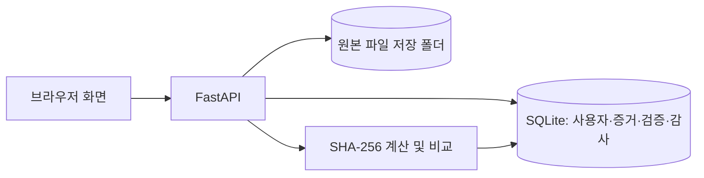
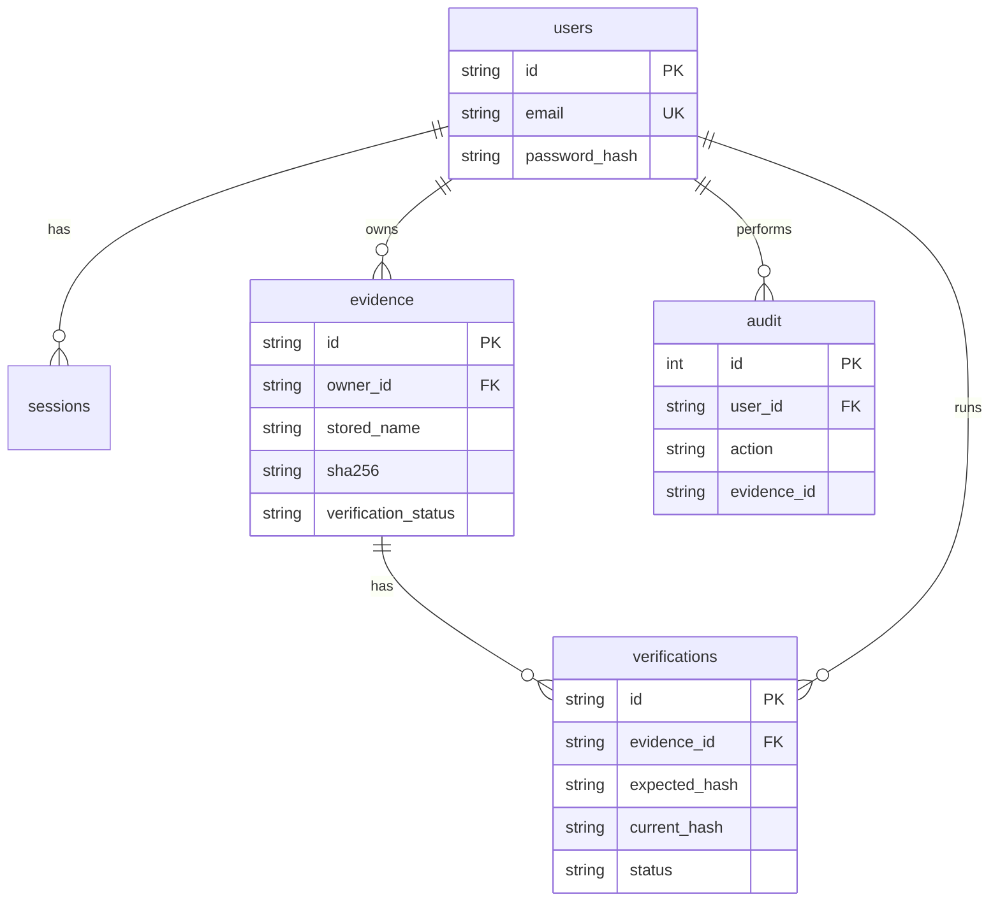

# EVIDENCE

디지털 증거 파일을 등록하고 SHA-256으로 원본 일치 여부를 재검증하는 캡스톤 프로젝트입니다. 로그인한 사용자는 자신의 파일만 조회·다운로드·검증할 수 있습니다. 증거 관리, 검증, 대시보드, 보고서 증거 선택 화면은 같은 서버 데이터베이스를 사용합니다.

## 기술과 실행

- 프런트엔드: HTML, CSS, JavaScript
- 서버: Python 3.11+, FastAPI, SQLite
- 파일 저장: `data/files/`, 메타데이터와 이력: `data/evidence.sqlite3`

```powershell
cd D:\CDamerica\capstone-design
python -m pip install -r requirements.txt
python -m uvicorn server.main:app --host 127.0.0.1 --port 8000
```

브라우저에서 `http://127.0.0.1:8000/`을 엽니다. `python -m http.server`나 GitHub Pages로 열면 서버 API 대신 이전 IndexedDB 시연 모드가 실행됩니다. 로그인 화면의 시연 링크로 진입할 수 있지만 실제 계정은 생성되지 않습니다. 실제 서버 저장 기능은 위 명령으로 확인해야 합니다. 외부 공개 시에는 HTTPS, 백업, 운영용 메일 인증과 배포 설정이 필요합니다. `EVIDENCE_DATA_DIR` 환경 변수로 데이터 폴더를 바꿀 수 있습니다. `data/`는 Git에서 제외됩니다.

## 주요 기능

1. 회원가입 후 로그인합니다. 서버는 비밀번호를 scrypt 해시로 보관하며 8시간 세션 토큰을 발급합니다. 로그아웃 시 세션을 폐기합니다.
2. 파일·이미지·영상/음성을 등록합니다. 허용 확장자만 받고 최대 크기는 50 MiB입니다. 서버가 업로드 중 SHA-256을 계산하고 원본을 임의의 저장 이름으로 보관합니다. 업로드 완료 후 원본 파일은 읽기 전용으로 설정합니다.
3. 증거 관리에서 이름·유형·상태·기간으로 찾고 상세 정보와 원본을 확인합니다. 목록은 10건씩 이동할 수 있고 여러 건을 선택해 검증 화면으로 보낼 수 있습니다.
4. 검증 시 서버가 저장 파일을 다시 읽어 SHA-256을 계산합니다. `일치`, `불일치`, `검증 불가` 상태와 실행 이력이 저장됩니다. 대시보드의 건수와 최근 활동, 보고서의 증거 선택에도 최신 상태가 표시됩니다.
5. 등록·로그인·업로드·다운로드·검증·비밀번호 변경·로그아웃은 감사 기록에 남습니다. `/api/audit`에서 현재 사용자 기록을 확인할 수 있습니다.

`mypage.html`은 `/api/me`, `/api/evidence`, `/api/audit`를 읽어 가입 시 입력한 이름·이메일·가입일, 증거·검증 건수, 최근 이용 내역을 표시합니다. `profile_edit.html`에서 이름을 바꾸면 서버 계정에도 저장되고 다음 로그인에도 유지됩니다. 최근 활동에는 현재 사용자의 서버 작업만 표시됩니다. 보고서 생성은 아직 브라우저 시연 기능이므로 마이페이지의 서버 활동 건수에 포함되지 않습니다.

등록 해시와 재검증 해시의 일치는 서버에 저장된 파일 바이트가 등록 시점과 같다는 뜻입니다. 등록 이전의 조작 여부나 내용의 진실성까지 증명하지는 않습니다. 읽기 전용 파일 권한은 일반적인 실수에 의한 수정을 줄이지만 서버 관리자나 파일 시스템 관리자의 변경까지 막지는 못합니다.

## API와 데이터 구조

| API | 기능 |
| --- | --- |
| `POST /api/auth/register`, `POST /api/auth/login`, `POST /api/auth/logout` | 계정과 세션 |
| `PUT /api/auth/password`, `GET /api/me`, `PUT /api/me` | 비밀번호 변경, 내 계정 조회·이름 수정 |
| `POST /api/evidence`, `GET /api/evidence` | 파일 등록, 내 증거 목록 |
| `GET /api/evidence/{id}`, `GET /api/evidence/{id}/download` | 상세, 원본 다운로드 |
| `POST /api/evidence/{id}/verify`, `GET /api/audit` | 재검증, 작업 이력 |

인증이 필요한 API에는 `Authorization: Bearer <token>` 헤더를 보냅니다. 업로드는 `multipart/form-data`의 `file`, `name`, `kind`, `source`, `description`, `memo`를 받습니다. API 문서는 서버 실행 후 `/docs`에서 볼 수 있습니다.





## 테스트와 시연

```powershell
python -m unittest discover -s tests -v
node tests/browser_smoke.cjs
```

브라우저 테스트는 로컬 서버가 `127.0.0.1:8177`에서 실행 중이어야 합니다. 다른 주소를 쓰면 `EVIDENCE_TEST_URL`을 설정합니다. Node 브라우저 테스트에는 Playwright와 Microsoft Edge가 설치되어 있어야 합니다. API 테스트는 임시 SQLite/파일 저장소를 사용합니다.

시연: 회원가입 → 로그인 → `evidence_file.html`에서 실제 파일 등록 → `evidence.html`에서 상세/선택 → `verification.html`에서 SHA-256 일치 확인 → 대시보드 건수 확인 → `report_select.html`에서 같은 파일 선택 → 검증 기록 다시 확인. 불일치 시연은 테스트 전용 저장소에서 원본 바이트를 변경해 재검증합니다. 실제 운영 증거 파일은 시연을 위해 수정하지 마세요.

## 현재 보류한 범위

- 이메일 인증코드는 화면 시연용이며 실제 메일은 발송하지 않습니다. 메일 공급자와 발송 계정 설정 후 서버에서 코드를 발급·검증해야 합니다.
- URL 수집과 보고서 PDF 생성은 기존 프런트엔드 시연 범위입니다. 서버 영속화와 증거 보존 체계에 포함되지 않습니다.
- 정적 페이지의 기존 Figma 생성 인라인 스타일·중복 헤더·일부 예시 콘텐츠는 전면 리팩터링 전 상태입니다. 핵심 파일 흐름 화면에는 공통 CSS, 반응형 규칙과 동적 실제 데이터 표시가 적용되었습니다.
- GitHub Pages는 정적 파일만 호스팅하므로 FastAPI와 원본 저장소를 실행할 수 없습니다. 배포용 서버가 준비되기 전에는 Pages 브랜치를 `main`으로 바꾸어도 서버 저장 기능이 작동하지 않습니다.

디자인 출처: [Figma 원본](https://www.figma.com/design/KTur9ZdEVI0DtyJmqPagru). 로그인·회원가입 SVG와 DM Sans 글꼴은 `assets/auth/`에 있으며 글꼴 라이선스도 함께 포함되어 있습니다.
